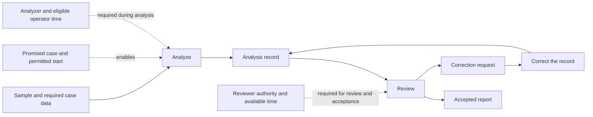
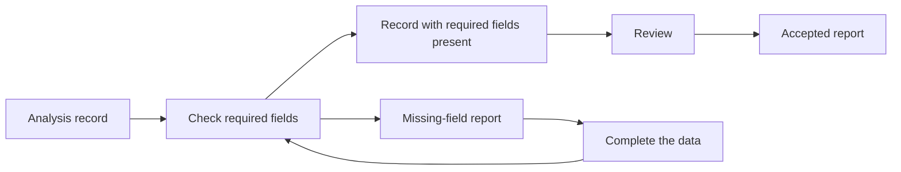

# OPS.11.1 - Construct and Reconcile Operating Models Across Scales: depth {#depth}

<status stage="spec" state="done"/>

> Source: Anatoly Levenchuk, *Operations Management Principles Framework* (20 September 2026), `Engineering DPF Suite/OPERATIONS-MANAGEMENT-PRINCIPLES-FRAMEWORK.md` at https://github.com/ailev/FPF commit d131d30a44e7, licensed CC BY 4.0. Depth sections of the pattern; the working sections are in the contract document of the same id. See LICENSE.md for the list of changes.

## OPS.11.1:5 - Archetypal Grounding {#archetypal-grounding}

### OPS.11.1:5.1 - Two departments share one operator {#two-departments-share-one-operator}

Three units need preparation and then inspection. Each step takes two hours of one operator's attention. Preparation and inspection are shown as separate departments, each with an eight-hour day. A departmental summary assigns six hours to each and appears to permit same-day completion.

Recovering the resource references shows that the same person performs both steps. The work needs twelve operator-hours. This excludes completion within eight hours under the stated arrangement, without needing a detailed simulation. Preparing and inspecting each unit in turn attains twelve hours if no other restrictions apply.

Now inspection changes: its first half-hour requires the operator, followed by one and a half hours of unattended machine operation. The operator demand becomes 7.5 hours, but that total alone does not prove an eight-hour schedule. With one inspection machine, a feasible sequence is:

| Unit | Preparation | Inspection with operator | Inspection unattended | Completion |
| --- | --- | --- | --- | ---: |
| 1 | 0–2 | 2–2.5 | 2.5–4 | 4 |
| 2 | 2.5–4.5 | 4.5–5 | 5–6.5 | 6.5 |
| 3 | 5–7 | 7–7.5 | 7.5–9 | 9 |

The machine's final unattended interval extends beyond the operator's work. Completion by hour eight is still impossible: preparing all three units and starting all three inspections needs 7.5 operator-hours, followed by the last inspection's 1.5 unattended hours. The schedule attains that nine-hour bound. Separating resource occupancy from elapsed processing gives the next design question: what can shorten or overlap that final tail?

### OPS.11.1:5.2 - Sample throughput does not determine order completion {#sample-throughput-does-not-determine-order-completion}

A laboratory has one machine that processes up to two samples in a four-hour batch. Order U needs samples u1 and u2; both are ready at zero. Order V needs v1, ready at hour three. No other work remains after the required samples finish.

Starting U's two samples at zero completes U at four. Processing V next completes V at eight. Waiting until hour three and batching u1 with v1 completes those samples at seven; u2 then completes at eleven. Both alternatives use two machine cycles and process three samples, yet the order completions differ: (4,8) versus (11,7).

For a promise U by five and V by nine, only the first alternative meets both. The model must retain the sample-to-order relation and the all-required completion condition. A total sample count cannot answer that promise. If partial results become useful to the customer, revise the receiving result rather than assuming the same all-required condition.

### OPS.11.1:5.3 - An outside service can remain compact {#an-outside-service-can-remain-compact}

A team must release a report by Friday. An external reviewer undertakes to return comments within one working day for the proposed submission class and volume. The team's comparison changes its internal preparation sequence but leaves that submission within the commitment.

The model needs the external review step, its working calendar and the team's response to comments. It can use the promised response as a conditional input without modeling the reviewer's internal allocation. If the proposal instead triples submissions beyond the commitment, that input no longer answers the changed use. Return to the external capacity or commitment question before relying on the old delay.

### OPS.11.1:5.4 - Change a report route while retaining its acceptance authority {#change-a-report-route-while-retaining-its-acceptance-authority}

A laboratory has promised an accepted report. Its operator produces an analysis record; a qualified reviewer examines that record and can require correction. Only the reviewer's acceptance makes the report available for the promised use. The same person may hold both roles if the applicable rules allow it; their occupied intervals must then be reconciled as one person's demand.

The solid arrows below pass named work products. The dotted links state conditions supplied by commitments, authority or resources; they do not pass the report or prescribe a sequence.

Suppose incomplete case data repeatedly occupy reviewer time. One proposal inserts an automated completeness check between the analysis record and review:

This second diagram shows only the changed route. The first diagram's start conditions, review authority, substantive correction return and resource constraints still apply. The automated check establishes field presence, not correctness or acceptance. Add its computing demand and the operator's completion work to the resource account; compare the saved review work with that added demand. The new route can be worse if it moves the bottleneck to a scarce operator. A simulation or trial is useful only if the remaining uncertainty can change the choice.

These proposals change different things:

| Proposal | What changes and what must be obtained |
| --- | --- |
| Give an already qualified and authorized reviewer a different case or time slot. | Reconcile that person's existing assignments and commitments through OPS.10–OPS.13 and OPS.19. The allocation need not change any authority relation. |
| Insert the completeness check under existing permission. | Compare the changed route and its resource consequences. OPS.16 can govern a useful trial; a locally usable operating arrangement can supply its conditions. |
| Let the operator accept reports without the previously required reviewer. | The proposed completion and authority relations change. Obtain the relevant professional acceptance decision and organization-design/assignment result before relying on the proposal. A faster route does not authorize it. |
| Introduce the route where staff cannot yet perform or sustain it. | Establish the needed capability, practice and support. Use the relevant development, Method-introduction or organization-change methods for that question; put their actual learning and support work into the same resource account. An unchanged organization chart does not supply those capabilities. |

The result is a comparison of identified changes and their consequences, with any missing decision left visible. It need not become a redesign of the whole organization.

These are constructed operating cases, not measured performance claims.

## OPS.11.1:6 - Bias-Annotation {#bias-annotation}

The examples favor discrete cases and identifiable completion events. Continuous production can require amounts and rates; an incident service can require continuing availability rather than a final case exit. Choose the modeled subjects from the receiving result. Do not force every operation into orders moving through a line.

The method also favors consequential detail. That can miss an effect outside the initially named decision. When a participant identifies a plausible displaced burden or failure, include the affected relation before treating the local comparison as sufficient.

## OPS.11.1:8 - Common Anti-Patterns and How to Avoid Them {#common-anti-patterns-and-how-to-avoid-them}

| Observed or text-invited mistake | Consequence | Repair |
| --- | --- | --- |
| Give each departmental box its own copy of a shared worker | Individually feasible plans compete for the same hours. | Reconcile resource references and impose the common occupancy constraint. |
| Sum or average local completions to obtain delivery | The result ignores joins and the final required contribution. | Derive the receiving completion event and its relation to local events. |
| Preserve a fixed service delay after changing its load | The comparison suppresses the congestion it may cause. | Reopen that service response under the proposed conditions. |
| Treat a changed route or a new assignment as proof of organizational redesign | Resource regulation becomes confused with changing who may promise or accept a result. | Compare the product, resource, commitment and authority relations separately, then obtain the result needed for each actual change. |
| Expand every box before comparing an alternative | Modeling consumes resources without improving the decision. | Refine the part whose omitted distinction can reverse the comparison. |

## OPS.11.1:10 - Architectural Rationale {#architectural-rationale}

Coordination uses several descriptions because the work supports several questions. Forcing them into a single hierarchy hides shared resources and cross-cutting relations. Leaving them disconnected permits incompatible assumptions. This method connects the quantities and participants needed for one operating decision while allowing the accounts to retain different purposes.

The outside result selects useful internal detail. The same principle also permits a return from an internal obstruction to a changed promise or wider arrangement. The direction is therefore iterative rather than a one-time decomposition.

The operating contribution is the construction of routes, resource use, joins, calendars and completion relations. General mathematical coupling, constraint formulation and computation remain available through their own methods. This keeps the domain method usable without creating a second general modeling language.

## OPS.11.1:11 - SoTA-Echoing {#sota-echoing}

To compare a change involving shared resources or several contributors to one result, choose the model's scope and detail from the receiving question. Adopt that purpose-led selection from [Robinson's conceptual-modeling tutorial (2017), §§2–6](https://informs-sim.org/wsc17papers/includes/files/041.pdf), and adapt it to the route, resource and completion construction in :4.2–4.5. The selected answer retains the relations that determine the requested consequence and leaves the rest compact. Robinson supplies the distinction between scope, detail, assumptions and simplifications; the operating constructions here make that selection usable before deciding whether computer simulation is needed.

A serious default is to combine departmental capacity and output totals. In :5.1 those totals conceal competition for one person; in :5.2 total sample throughput does not determine either order's completion. Recovering the shared resource and the sample-to-order join corrects those answers without describing every internal action. It costs an inquiry into the relevant identities and timing, but the first case can already be rejected by an arithmetic bound. Conversely, a detailed schedule of every supplier would add inquiry and maintenance without changing :5.3's comparison: its conditional one-day commitment is sufficient. Sections :4.4–4.5 therefore construct or test a sufficient summary and refine only a consequential omission.

[Hopp and Spearman, Factory Physics, third edition](https://www.waveland.com/browse.php?t=587), supplies production reasoning about batches, capacity and variability for identifying these dependencies. Applying one of its relations to another kind of operation still requires recovering the corresponding subjects and events. [Oliveira, Sagawa and Mušič (2025)](https://apem-journal.org/Archives/2025/APEM20-1_029-042.pdf) offers a continuous, feedback-controlled workload account as another choice. For sustained aggregate regulation, a compact continuous account can avoid event-level detail; use it when its flow relation and capacity-control mechanism fit the operation. For an individual deadline, retain the individual completion relation or obtain a justified bound; continuous draining alone does not determine that event. Neither the production relations nor the control paper establishes adequacy for every service.

Dietz and Mulder's *Enterprise Ontology* (2020), §§4.4.4–4.4.6, distinguishes acts that produce a result from acts that establish and discharge commitments, and distinguishes their coordination structure from one sequential flow. The useful contribution here is to preserve request, promise and acceptance relations while calculating the work and resources that carry them. This method does not adopt a universal tree structure, human-only agency or a claim that the organizational model alone determines every operating consequence. Section :5.4 keeps an unchanged authority arrangement while changing the product route; a different proposal changes the acceptance relation and therefore needs another supplying method.

Anderson's *Kanban* (2010), chapter 1 and chapter 10's capacity-allocation discussion, combines regulation of work in progress with an approach to introducing changed practice. The [Kanban change principles](https://kanban.university/kanbans-change-management-principles/) explicitly distinguish change management from service delivery. Use the relevant operating rule and assess its introduction separately. In particular, allocating WIP slots among work classes does not by itself establish staffing, elapsed service time or the authority to change a commitment. Those remain modeled conditions.

Reconsider this choice when a changed promise, resource or policy makes an omitted relation affect the answer, or when an alternative construction obtains the same required answers with less inquiry and maintenance. A newly observed coupling reopens the affected account, not every part of the operation.

## OPS.11.1:End {#end}
